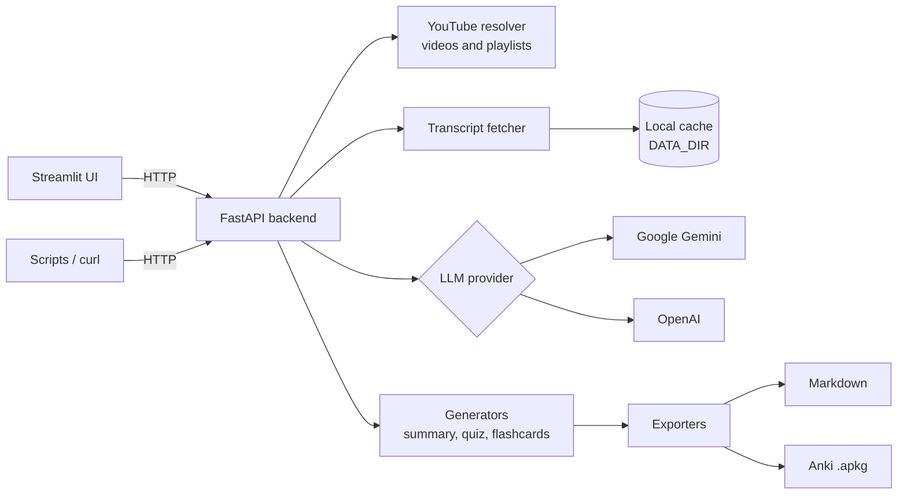

<div align="center">

# yt-learn

**Turn YouTube videos and whole playlists into summaries, quizzes, flashcards, and study notes.**

[](https://github.com/Junaidjameel773/yt-learn/actions/workflows/ci.yml)
[](https://www.python.org/)
[](LICENSE)
[](#roadmap)

</div>

## Overview

yt-learn is a learning assistant for YouTube. Point it at a video or a full playlist and it
fetches the transcripts, summarizes them with an LLM (Google Gemini or OpenAI), and generates
study material: quizzes, flashcards, and structured notes you can export to Markdown or import
into Anki.

It ships as a FastAPI backend with a Streamlit UI on top, so you can use it from the browser
or call the API directly from your own scripts.

## Features

| Feature | Description | Status |
| --- | --- | --- |
| Video and playlist input | Accept a video or playlist URL and resolve all video IDs | Planned |
| Transcript fetching | Download and cache transcripts, with language selection | Planned |
| Video summaries | Concise summary and key points per video | Planned |
| Playlist summaries | Combined course-level summary across a whole playlist | Planned |
| Quiz generation | Multiple-choice questions with answers and explanations | Planned |
| Flashcards | Question/answer cards generated from the transcript | Planned |
| Markdown export | Notes, summaries, and quizzes as a Markdown file | Planned |
| Anki export | Flashcards as an importable `.apkg` deck | Planned |
| Pluggable LLM providers | Switch between Gemini and OpenAI via configuration | Planned |
| Streamlit UI | Browser UI for the full workflow | Planned |

## Architecture



## Quick start

Requires Python 3.11+ and [uv](https://docs.astral.sh/uv/).

```bash
git clone https://github.com/Junaidjameel773/yt-learn.git
cd yt-learn
uv sync
cp .env.example .env   # add your API key
uv run uvicorn yt_learn.api:app --reload
```

Then open http://localhost:8000/health or the interactive docs at http://localhost:8000/docs.

## Configuration

All settings are read from environment variables (or a `.env` file).

| Variable | Description | Default |
| --- | --- | --- |
| `LLM_PROVIDER` | LLM backend to use: `gemini` or `openai` | `gemini` |
| `GEMINI_API_KEY` | Google Gemini API key | (empty) |
| `OPENAI_API_KEY` | OpenAI API key | (empty) |
| `LLM_MODEL` | Optional model override for the selected provider | provider default |
| `DATA_DIR` | Directory for cached transcripts and exports | `./data` |
| `API_URL` | Base URL the Streamlit UI uses to reach the API | `http://localhost:8000` |

## API

| Method | Path | Description | Status |
| --- | --- | --- | --- |
| `GET` | `/health` | Service health and version | Available |
| `POST` | `/videos/resolve` | Resolve a video or playlist URL to video IDs | Planned |
| `GET` | `/videos/{video_id}/transcript` | Fetch the transcript for a video | Planned |
| `POST` | `/summaries` | Summarize a video or playlist | Planned |
| `POST` | `/quizzes` | Generate a quiz | Planned |
| `POST` | `/flashcards` | Generate flashcards | Planned |
| `POST` | `/exports/markdown` | Export notes as Markdown | Planned |
| `POST` | `/exports/anki` | Export flashcards as an Anki deck | Planned |

Example:

```bash
curl http://localhost:8000/health
# {"status":"ok","version":"0.0.1"}
```

## Development

```bash
uv sync                      # install dependencies
uv run pytest                # run tests
uv run ruff check .          # lint
uv run ruff format .         # format
uv run ruff format --check . # verify formatting (as in CI)
uv run uvicorn yt_learn.api:app --reload  # run the API locally
```

## Roadmap

### v0.1 - Core

URL parsing, playlist resolution, transcript fetching and caching, settings, and API endpoints for the raw data.

### v0.2 - AI generation

LLM provider abstraction (Gemini and OpenAI), video and playlist summaries, quizzes, and flashcards.

### v0.3 - Export and UI

Markdown and Anki export, and a Streamlit UI covering the full workflow.

### v0.4 - Ship-ready

Error handling, Docker image, release workflow, and complete documentation.

See the [milestones](https://github.com/Junaidjameel773/yt-learn/milestones) for the detailed issue list.

## License

Released under the [MIT License](LICENSE).
